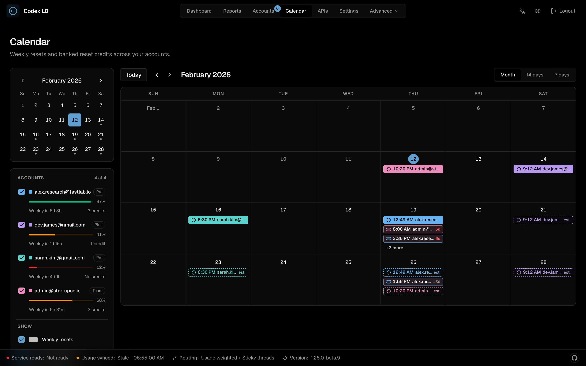
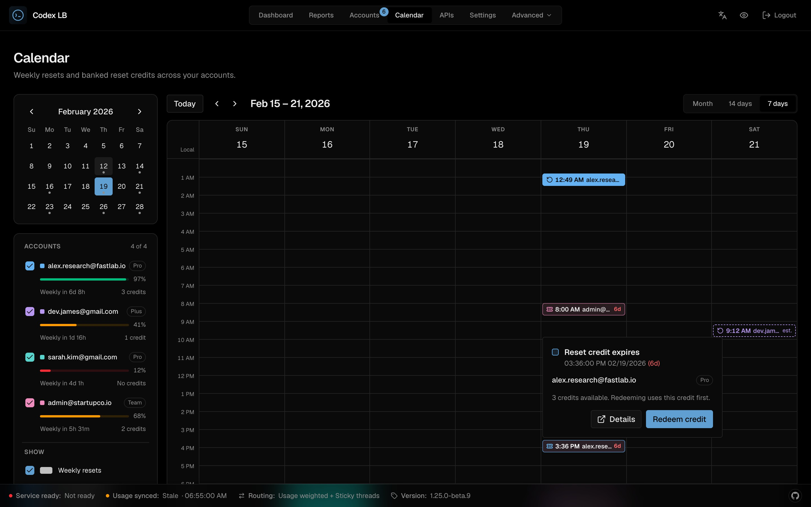

# Reset Calendar

The **Calendar** page in the dashboard (`/calendar`) puts every account's weekly quota resets and banked rate-limit reset credits on one timeline. Use it to see when capacity comes back across the pool and which credits are about to lapse.

## Views

- **Month** shows every week that touches the month; step forward to see later months.
- **14 days** and **7 days** are time grids starting on Sunday, with each event at its exact time and a line marking the current time on today.

The view and the date are kept in the address (`/calendar?view=7d&date=2026-10-22`), so a view can be bookmarked or shared. In the month view a day shows up to three events; **+N more** opens the 7-day view for that day. On a phone, the month shows coloured dots and the selected day's events are listed below it.

## What it shows

| Event | Looks like | Source |
|---|---|---|
| Weekly reset | Solid chip in the account's colour | The account's next weekly reset (the same value as "Reset in 6d 8h" on the account card) |
| Estimated weekly reset | Dashed chip marked **est.** | Projected every weekly window after the known reset |
| Reset credit expires | Outlined chip with a ticket icon and a countdown (red under 7 days) | Each available banked credit; the filled ticket is the credit a redeem uses first |

codex-lb only knows each account's *next* weekly reset. Later weeks are estimates: the real time is confirmed once the previous reset happens. Five-hour and monthly windows are not shown.

## Filtering and actions

The sidebar lists every account with its weekly-remaining bar and credit count. Untick an account to hide its events, or switch weekly resets, estimated resets, and credit expiries on and off. These choices are remembered in the browser only. Account emails follow the dashboard's **Hide Emails** toggle.

Selecting an event opens its details. A credit expiry offers **Redeem credit** to sessions that can change accounts (`accounts:write`); it opens the same confirmation as the Accounts page and redeems the soonest-expiring credit. Read-only sessions see the details without the action.

The page reads the existing account list and per-account reset-credit data; it adds no settings, and it fetches credit details only for accounts that report available credits.

*Spec: [frontend-architecture](https://github.com/Soju06/codex-lb/tree/main/openspec/specs/frontend-architecture)*
